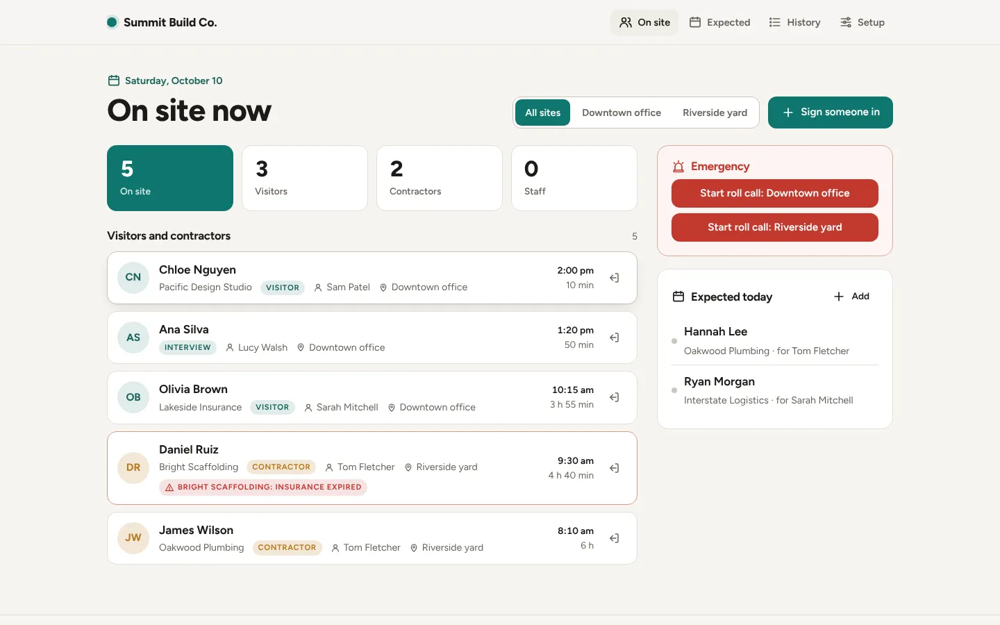
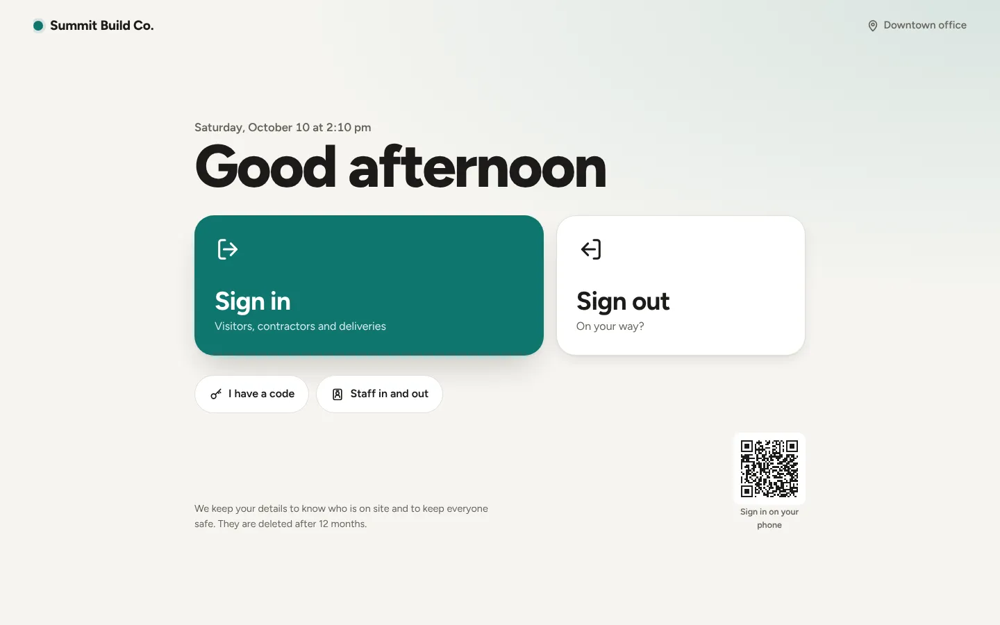
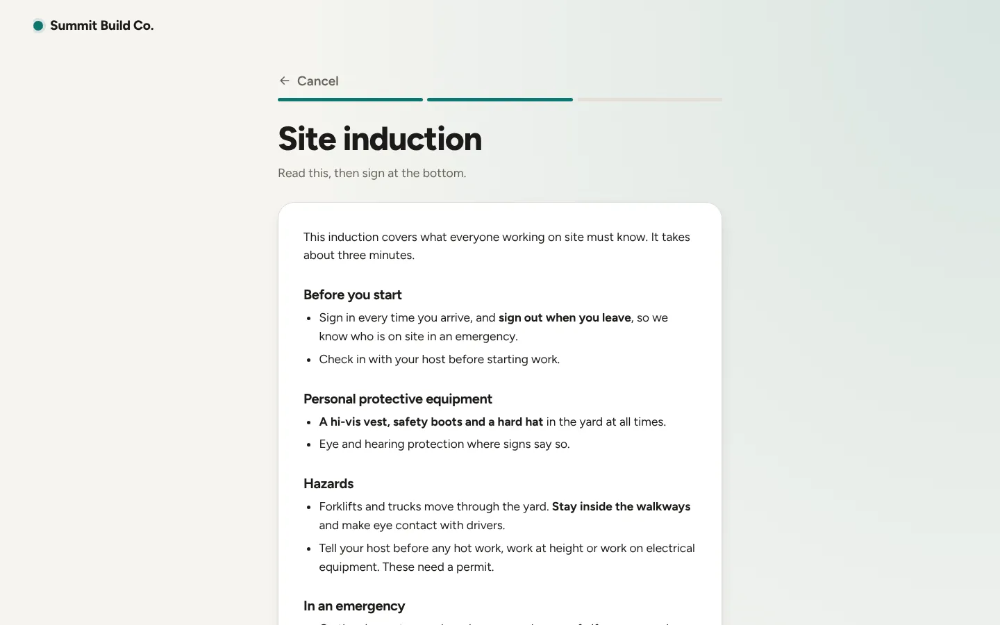
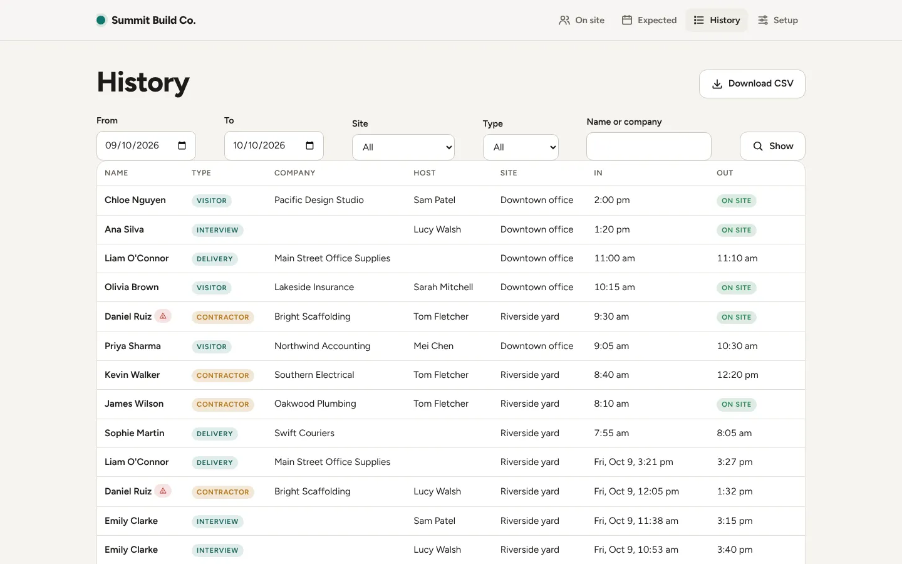
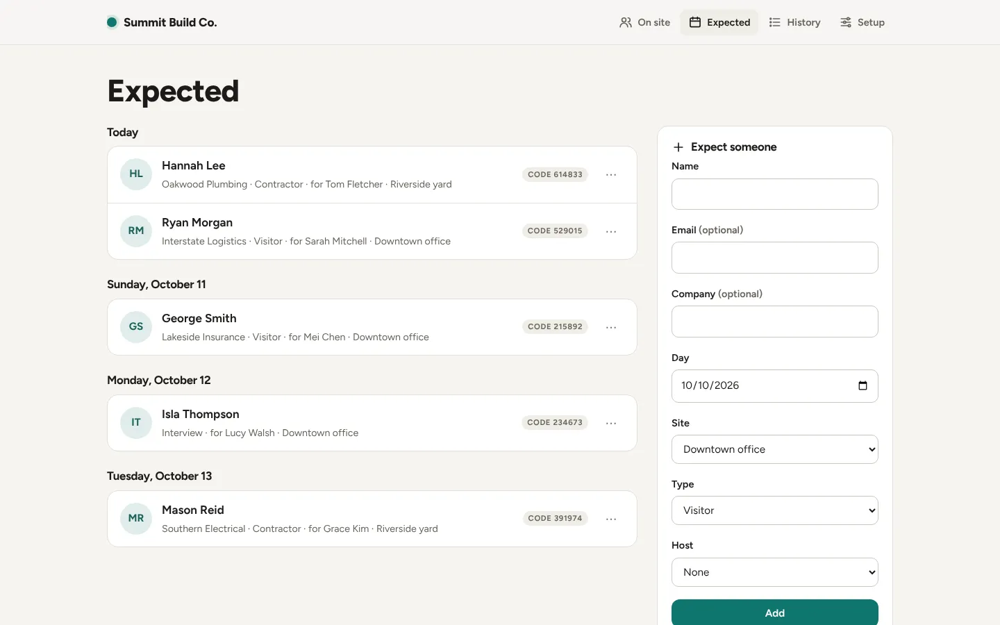
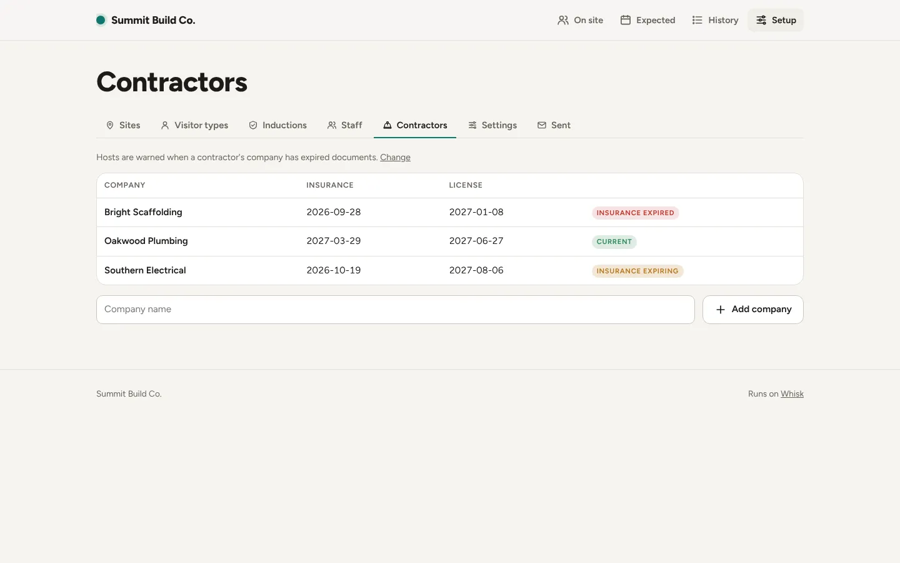
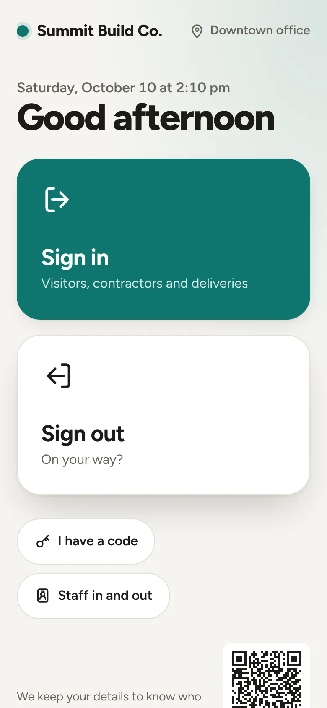
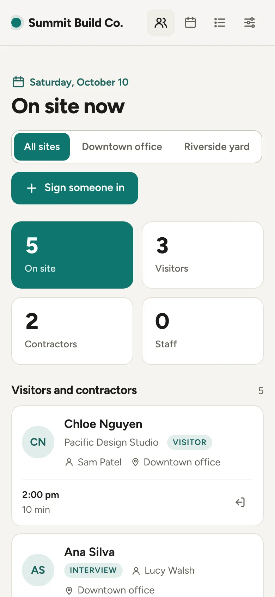

# Site sign-in

Site sign-in for visitors and contractors, also called visitor management: a tablet kiosk, site inductions with a quiz and a signature, host alerts, and a live list of who is on site with a one-tap roll call for emergencies. It replaces Sine, Envoy and SignInApp for most small businesses, with no per-site pricing.



**[See it live](https://visitors.examples.whisk.page)**. Press **Look around** to use it as staff, or **Try the kiosk** to sign in as a visitor. It resets every night.

## Deploy your own

Paste this into Claude Code, Codex, Cursor or any coding agent:

> Read https://whisk.run/skill. Then clone https://github.com/Whisk-Hosting/site-sign-in, deploy it to Whisk as a new app, and give me its address.

Your agent signs you up to Whisk if you're new, deploys the app, and gives you its address. It comes with sample data so every screen has something to show.

Once it's live, ask your agent to make it yours in plain words, for example:

> Change the name to Maple Street Dental, use our logo and blue, and rename the site to Front office.
>
> Add a "Vehicle plate" field for contractors and show it on the History page and in the CSV.
>
> Send me a daily email at 5 pm listing anyone who is still signed in.

Prefer the command line? In a copy of this folder:

```
whisk init --name site-sign-in
whisk deploy
```

A new install starts with a "Main office" site, two inductions and four visitor types. Open the app, sign in, and go to **Setup**: rename the site, add your staff, then open the site and press **Use this device** on the tablet that will sit at the front desk.

## What is Whisk?

[Whisk](https://whisk.run) hosts business apps built with AI coding agents. Your agent creates the account, pushes the app, and it's live at its own address with sign-in, a database, backups, scheduled jobs, email and security already taken care of. This app is one of the [Whisk examples](https://whisk.run/examples): open source, MIT licensed, and yours to change.

## Screenshots

<table>
  <tr>
    <td width="50%"><br><sub>The kiosk at the front desk</sub></td>
    <td width="50%"><br><sub>A site induction, read and signed at sign-in</sub></td>
  </tr>
  <tr>
    <td><br><sub>History with filters and a CSV download</sub></td>
    <td><br><sub>Expected visitors, each with a code</sub></td>
  </tr>
  <tr>
    <td><br><sub>Contractor insurance and license checks</sub></td>
    <td>
      
      <br><sub>Phone sign-in and the On site screen on a phone</sub>
    </td>
  </tr>
</table>

## Features

**At the front desk**
- **Kiosk.** A tablet paired once with a six-digit code or **Use this device**. Visitors choose why they're here (Visitor, Contractor, Delivery, Interview, or your own types) and fill in only what that type asks.
- **Back to the start by itself** once someone is signed in, ready for the next person.
- **Phone sign-in.** Each site has a QR poster. A phone that scans it signs in the same way as the kiosk, and remembers the visitor next time.
- **Signing out** at the kiosk by typing a name, on the visitor's own phone, by the front desk, or automatically at 11 pm.
- **Staff in and out** on the kiosk, so the roll call includes your own people.

**Safety**
- **Inductions** in Markdown with an optional video, a quiz with a pass mark, and a drawn signature.
- **Passes last** the months you set (or one visit), so a returning visitor skips what they already hold. Changing an induction's text or questions makes everyone do it again.
- **On site now.** Everyone in, by site, with visitors, contractors and staff counted.
- **Roll call.** One tap turns the list into tap-to-mark-safe for the assembly point.

**Hosts and contractors**
- **Hosts are told** by email the moment their visitor signs in, and the team's Slack or Teams channel gets a line too.
- **Expected visitors** get an email with a code and a link to do their details and induction before they come, so signing in when they arrive is one tap.
- **Contractor companies** with insurance and license expiry dates. A lapsed company is flagged to the front desk, or turned away if you choose. Admins get an email two weeks before a date passes.

**Records and privacy**
- **History** filtered by day, site, type and name, with a CSV export.
- **Visits are deleted** after the months you set (12 by default). Photos are off unless you turn them on.
- **Forget a person.** An admin can delete everything about one person at once.

**Who is who.** Everyone in your business's team on Whisk can use the front desk screens. **Admins** (owners, admins and the `reception-admins` group) also change setup and delete records. Visitors never sign in: the kiosk, the QR poster and the invite link are the only public pages.

## API

Everything the front desk does on its screens can be done by a script or an AI agent through a JSON
API under `/api/v1`: sites, who is on site now, visits (history with filters, sign someone in,
sign someone out), expected visitors (invite, list, cancel), staff, contractor companies, and
roll calls (start, mark people safe, finish).

An admin makes a key under **Setup > Settings > API keys**. It starts with `vis_`, is shown once,
and only its hash is kept. Send it as `Authorization: Bearer <key>` (or `X-Api-Key`, Basic auth
with the key as the username, or `?token=`):

```
curl https://<your app>/api/v1/on-site -H "Authorization: Bearer vis_..."

curl "https://<your app>/api/v1/visits?from=2026-10-01&to=2026-10-31&q=oakwood" -H "Authorization: Bearer vis_..."

curl -X POST https://<your app>/api/v1/visits -H "Authorization: Bearer vis_..." \
  -H "Content-Type: application/json" \
  -d '{"site_id": 1, "type_id": 3, "full_name": "Sophie Martin", "company": "Swift Couriers"}'

curl -X POST https://<your app>/api/v1/invites -H "Authorization: Bearer vis_..." \
  -H "Content-Type: application/json" \
  -d '{"site_id": 1, "full_name": "Ana Silva", "email": "ana@example.com", "expected_on": "2026-12-01", "host_id": 2}'

curl -X POST https://<your app>/api/v1/roll-calls -H "Authorization: Bearer vis_..." \
  -H "Content-Type: application/json" -d '{"site_id": 1}'
```

`GET /api/v1` lists every endpoint. Lists take `?limit=` (up to 200) and `?offset=` and answer
`next_offset`, null on the last page. Errors are `{"error": {"code", "message", "fix"}}` with
400, 401, 404, 409 or 422. A sign-in through the API runs the kiosk's own checks: the fields the
visitor type asks for, the contractor rules, and inductions. Inductions need the visitor's
signature, so someone with one due gets `INDUCTION_DUE` and signs in at the kiosk or on their
phone. Hosts are emailed and the chat channel told, as they are for any sign-in.

## How it's built

Hono on Node 22, Postgres through `postgres`, Markdown through `marked`, QR codes through
`qrcode`, server-rendered HTML with a little JavaScript, no front-end framework. Functional style:
decisions are pure functions over immutable data, and the routes are thin shells that load rows,
decide, and store. A sign-in in progress travels between steps as a signed token in the form, so
nothing is written until the visitor finishes.

Whisk provides sign-in for staff (`X-Whisk-*` headers), the database, uploads and video
(`storage: true`), email (`email: true`), and the queue and schedules (`functions`). Public pages
that change anything sit behind Whisk's proof-of-work challenge, so a bot can't fill the list.

### Where things live

The code is small and plain on purpose.

```
src/model.ts         every decision, as pure functions: inductions due, grading, contractor
                     checks, the sign-in form, roll calls, times. Start here.
src/store.ts         one small SQL query per function
src/routes/signin.ts the visitor's steps, shared by the kiosk, phone, invite and staff board
src/routes/staff.ts  on site, roll call, expected visitors, history
src/routes/setup.ts  sites, kiosks, types, inductions, staff, contractors, settings, API keys
src/api.ts           the JSON API under /api/v1; its pure parts are in src/api-model.ts
src/views/           HTML (hono/html, escaped by default), styles.ts, scripts.ts, icons.ts
src/notify.ts        the emails and chat posts, written down first, then sent by the queue
src/functions.ts     sending and the nightly sign-out, clean-up and expiry warnings
src/seed.ts          what a new install starts with
migrations/          plain SQL, run in order before each release
```

- **What a visitor is asked**: visitor types under **Setup**, each with its own fields, questions
  and inductions. No code needed.
- **Look**: the business name and accent color are settings; everything else is CSS custom
  properties at the top of `styles.ts`. Dark mode follows the device.
- **Contractor rules**: `companyState` and `admit` in `model.ts`.
- **When people are signed out**: the `nightly` function in `functions.ts`.

## Run it locally

With Postgres running:

```
npm install && npm run build
DATABASE_URL=postgres://… node dist/migrate.js
DATABASE_URL=postgres://… PORT=8080 WHISK_DEV=1 node dist/index.js
```

With `WHISK_DEV=1` and no Whisk variables, uploads and email are answered locally, so every
screen works. `whisk dev --as you@example.com --roles owner` runs it with sign-in too.

`npm test` runs the unit tests.

## The demo

`demo/whisk.yaml` is the manifest of the live demo: every route public, every change behind a
proof-of-work challenge, and `DEMO=1`, which turns on the **Look around** guest and the shared
demo kiosk, records emails without sending them, refuses uploads, and resets the sample data at
3 am every night, API keys included. The guest can make API keys to try the API on the sample
data; `/api/**` is left out of the challenge, since scripts can't solve one. It all lives in `src/demo.ts`. `WHISK_DEMO_APP=<org>/<app> npm run deploy:demo` deploys it.
A normal deploy never uses any of it.

## License

MIT
